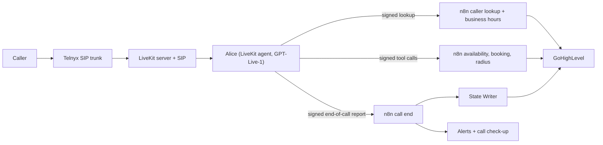

# Desert Comfort HVAC: AI Receptionist on LiveKit

A self-hosted inbound AI receptionist for an HVAC company. It answers day and night, scores how urgent the AC problem is, quotes the right fee, checks the service area and books the visit. Built on LiveKit Agents with OpenAI GPT-Live-1, n8n and GoHighLevel, over a Telnyx SIP trunk.

## What it does

- Before picking up, the agent looks the caller up in GoHighLevel (GHL) through n8n. The lookup returns who the caller is (new, returning or an existing client) and whether the business is open.
- "Alice" asks the qualifying questions, scores the call as an emergency (inside temperature 90 °F or higher) or standard, quotes the matching fee, checks the address is inside the service area and books a visit on the right calendar.
- Existing clients are greeted by name, with their address and last visit on file. Returning callers who haven't booked are greeted by name when a usable one is on file.
- After hours, emergencies can still be booked on the 24/7 emergency calendar. Standard bookings are limited to business hours.
- Callers can opt out of calls or texts, and take it back, during the call. Text replies of STOP and START are mirrored to the CRM's do-not-disturb settings.
- After every call, the agent sends one signed end-of-call report. n8n writes the outcome to GHL, sends the right alerts and runs an automatic check-up on the call.

## How it works



## What's in this repo

```
agent/          The LiveKit agent and its prompt (4 variants)
n8n/            Five n8n workflows (see below)
state_writer/   The State Writer's decision code, with its own README
```

| Workflow | Nodes | What it does |
|---|---|---|
| `receptionist-flows.json` | 228 | Caller lookup, tool calls, call end, appointment-status updates, agent heartbeat, Telnyx SMS STOP/START, delete-contact utility |
| `state-writer.json` | 26 | The one place a contact's stage changes (see `state_writer/README.md`) |
| `contact-gate.json` | 12 | Checks a contact's do-not-disturb settings before any SMS goes out |
| `drift-watchman.json` | 50 | Agent-down alert (every 15 min), CRM drift check (every 4 h), dormant-contact sweep (daily) |
| `call-checkup-daily-digest.json` | 7 | Daily summary of the call check-up findings |

## Stack

| Layer | Tool |
|---|---|
| Voice | LiveKit Agents with OpenAI GPT-Live-1, self-hosted |
| Telephony | Telnyx SIP trunk into LiveKit SIP |
| Orchestration | n8n |
| CRM and calendars | GoHighLevel |
| State and locks | Redis, n8n Data Tables |
| Alerts | Slack, email, Telegram |

## Agent tools

| Tool | Purpose |
|---|---|
| `check_availability_desertcomfort` | Reads open slots on the standard or emergency calendar |
| `book_appointment_desertcomfort` | Books the visit |
| `radius_checker_desertcomfort` | Checks the address is inside the service area |
| `transfer_to_human` | Hands the call to a person |
| `opt_out_desertcomfort` | Stops calls and/or texts to the caller |
| `grant_opt_in_desertcomfort` | Restores only the channels the caller agrees to |
| `get_current_time` | Gives the agent the current Phoenix time |
| `hangup` | Ends the call |

## Why day and night share one agent

The lookup returns `hours_mode` (`day` or `night`) and the agent loads one of four prompt variants: new caller, existing client, after-hours new caller, after-hours existing client. Everything else stays the same: the tools, the backstops, the end-of-call report and the check-up. One agent means one set of safety code to maintain, and a fix made for the day calls also protects the night calls. If the lookup fails, the agent uses the day variant, its most tested path. The booking side enforces the hours on its own: standard visits only inside business hours, emergency visits at any time.

## Key design decisions

- **Look up before answering.** The agent prepares the caller's details and the business-hours mode before it connects, so the first words already fit the caller.
- **Two-tier prompt.** GPT-Live-1 runs the live conversation from a voice layer. A thin backend layer only builds tool-call arguments. Both layers and all four variants are in `agent/receptionist-prompt.md`.
- **Code backstops for what the model can miss.** Facts the caller has already given (temperature, unit, name, address) are captured from the transcript and handed back to the model, so it never re-asks. If the caller opts out and the model doesn't call the tool within 3.5 seconds, code calls it. Only one mechanism can end a call, and it waits for the agent's last words to finish playing.
- **Every webhook is authenticated.** The agent signs each request with HMAC. Telnyx SMS webhooks are checked against Telnyx's Ed25519 signature.
- **The report survives a failed send.** The end-of-call report is saved to an outbox first and resent every few minutes until n8n confirms it (for up to 7 days, n8n's duplicate window). A Redis guard stops a resent report from being processed twice.
- **One writer for contact state.** Stages only move forward, unknown values stop and alert instead of guessing, and do-not-disturb is only ever set by the State Writer, never cleared.
- **Watch the system, not only the calls.** A heartbeat alerts if the agent goes silent for 20 minutes. A drift check compares contact stages with real GHL appointments, and fixes only what it can map with certainty. A call check-up flags wrong bookings, wrong fee tiers and missed opt-outs.

## Tests

The agent has 10 test suites with 696 checks, and the State Writer has 68 more.

## Placeholders

| Placeholder | Replace with |
|---|---|
| `your-n8n-instance.example.com` | Your n8n base URL |
| `YOUR_WEBHOOK_PATH` | The webhook paths you choose |
| `YOUR_GHL_LOCATION_ID` | Your GHL location ID |
| `YOUR_GHL_STANDARD_CALENDAR_ID` | Your GHL calendar for standard visits |
| `YOUR_GHL_EMERGENCY_CALENDAR_ID` | Your GHL calendar for emergency visits (24/7) |
| `YOUR_GHL_USER_ID_2`, `YOUR_GHL_USER_ID_3`, `YOUR_GHL_USER_ID_4` | Your GHL staff user IDs |
| `YOUR_GHL_FIELD_ID_LAST_SERVICE_DATE`, `YOUR_GHL_FIELD_ID_LEAD_STATUS`, `YOUR_GHL_FIELD_ID_SERVICE_ADDRESS`, `YOUR_GHL_FIELD_ID_STAGE` | Your GHL custom field IDs (the name says which field) |
| `YOUR_BUSINESS_PHONE_NUMBER` | The phone number texts are sent from |
| `YOUR_SLACK_USER_ID` | The Slack user who gets the alerts |
| `YOUR_CONTACT_GATE_WORKFLOW_ID`, `YOUR_ERROR_WORKFLOW_ID`, `YOUR_STATE_WRITER_WORKFLOW_ID` | Your n8n sub-workflow IDs |
| `YOUR_CALL_CHECKUPS_TABLE_ID`, `YOUR_CONFIG_TABLE_ID`, `YOUR_CONTACT_EVENTS_TABLE_ID`, `YOUR_STAGE_TRANSITIONS_TABLE_ID` | Your n8n Data Table IDs |
| `YOUR_TELEGRAM_CHAT_ID` | The Telegram chat that gets after-hours emergency alerts |
| `YOUR_HVAC_SIGNING_SECRET` | The same value as `HVAC_SIGNING_SECRET` in `.env` (in the signature-check nodes) |
| `YOUR_BASE64_PUBLIC_KEY` | Your Telnyx account's public key, for the SMS webhook signature check |

## License

All rights reserved. Published for viewing only. See [LICENSE](LICENSE).
